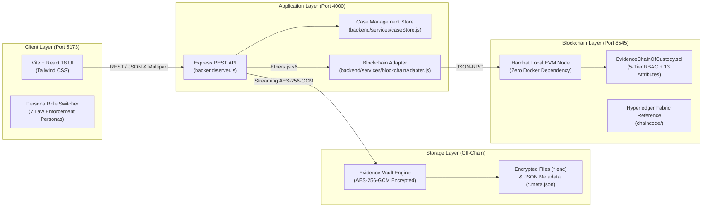
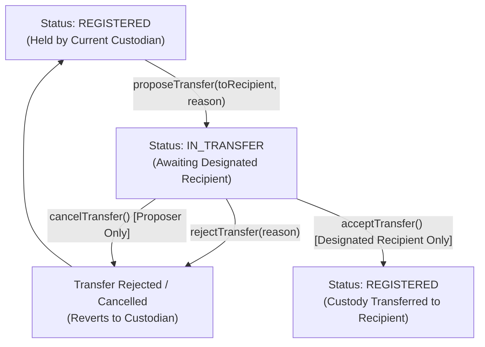

# ForensiChain: Blockchain-Based Digital Evidence Chain-of-Custody System

[](https://soliditylang.org/)
[](https://hardhat.org/)
[](https://react.dev/)
[](https://vitejs.dev/)
[](https://tailwindcss.com/)
[]()
[]()
[-success.svg)]()

> **ForensiChain** is a tamper-evident, production-ready digital evidence chain-of-custody platform. It maintains verifiable, mathematically non-repudiable records of forensic evidence intake, secure off-chain encrypted custody, cryptographically enforced two-party handovers, contemporaneous dual-timestamped access logs, and automated integrity verification aligned with Section 63 of the Indian **Bharatiya Sakshya Adhiniyam, 2023 (BSA)**.

---

## Table of Contents
1. [Overview & Key Capabilities](#overview--key-capabilities)
2. [Hybrid System Architecture](#hybrid-system-architecture)
3. [Two-Party Custody Handover Protocol](#two-party-custody-handover-protocol)
4. [Smart Contract Specification](#smart-contract-specification)
5. [BSA 2023 Section 63 Legal Mapping & Admissibility Boundaries](#bsa-2023-section-63-legal-mapping--admissibility-boundaries)
6. [Windows-Native Zero-Docker Quickstart](#windows-native-zero-docker-quickstart)
7. [REST API Reference](#rest-api-reference)
8. [Persona Simulator & Interactive UI Guide](#persona-simulator--interactive-ui-guide)
9. [Adversarial Single-Bit Tamper Demonstration](#adversarial-single-bit-tamper-demonstration)
10. [Automated Test Suites & Verification](#automated-test-suites--verification)

---

## 1. Overview & Key Capabilities

Digital evidence presented in criminal proceedings is vulnerable to claims of unauthorized tampering, broken chain of custody, and unrecorded access. ForensiChain resolves these challenges by uniting **NIST FIPS PUB 180-4 SHA-256 cryptographic hashing**, **AES-256-GCM authenticated off-chain encryption**, and an **immutable EVM smart contract ledger**:

- **Off-Chain Encrypted Vault (`EvidenceVault`)**: Heavy forensic artifacts (disk bitstreams, CCTV video, database dumps) are never published unencrypted or on-chain. Files are streamed through AES-256-GCM encryption with unique 12-byte random IVs and 16-byte authentication tags at rest.
- **On-Chain Baseline Anchoring (`EvidenceChainOfCustody.sol`)**: In-flight calculated SHA-256 digests and 13 comprehensive forensic metadata attributes are anchored to the blockchain with block-height and UNIX timestamps.
- **Two-Party Custody Handover Protocol**: Evidence transfers are an atomic state machine (`REGISTERED` &rarr; `IN_TRANSFER` &rarr; `REGISTERED`). Transfers require an explicit proposal by the current custodian and mutual cryptographic acceptance by an authorized recipient.
- **Access Audit Trail**: Every inspection, examination, analysis, or export operation is logged with actor address, role, action, purpose, and block timestamp.
- **Cryptographic Verification Engine**: Dynamic re-hashing of stored vault objects or uploaded exhibits against on-chain baselines, emitting immutable `IntegrityChecked(isMatch)` events (`PASS` vs `HASH MISMATCH ALERT`).
- **BSA 2023 Section 63 Electronic Record Certificate**: Automated generation of printable courtroom audit certificates with contemporaneous dual timestamps, parent-child forensic derivation lineage, and legal boundary disclosures.

---

## 2. Hybrid System Architecture

ForensiChain uses a hybrid architecture separating high-throughput bulk binary storage from immutable consensus verification:



### Text Architectural Overview
```
+-------------------------------------------------------------------------+
|                  FORENSICHAIN HYBRID ARCHITECTURE                       |
+-------------------------------------------------------------------------+
| [REACT 18 WEB APP :5173]                                                |
|   * Case Dashboard          * Evidence Passport (13 attributes)         |
|   * Custody Timeline        * Two-Party Handover Modal                  |
|   * Drag-and-Drop Verifier  * BSA Section 63 Courtroom Certificate View |
|   * Persona Switcher (Collector, Custodian, Examiner, Auditor, Admin)    |
+------------------------------------+------------------------------------+
                                     | HTTP / Multipart Streaming
+------------------------------------v------------------------------------+
| [EXPRESS REST API SERVER :4000]                                         |
|   * In-flight SHA-256 computation (NIST FIPS PUB 180-4)                |
|   * Streaming AES-256-GCM encryption & decryption                       |
|   * Pluggable BlockchainAdapter (EVM Primary / Fabric Reference)       |
+------------------+----------------------------------+-------------------+
                   |                                  |
                   v (Off-Chain Encrypted Payload)     v (JSON-RPC :8545)
+------------------------------------+ +----------------------------------+
| [OFF-CHAIN EVIDENCE VAULT]         | | [HARDHAT EVM LEDGER]             |
|   * vault/<objectId>.enc           | |   * EvidenceChainOfCustody.sol   |
|   * vault/<objectId>.meta.json     | |   * 5 Institutional Roles (RBAC) |
|   * Authenticated Tag Verification | |   * 13 Forensic Metadata Fields  |
|   * Zero Raw Plaintext at Rest     | |   * Two-Party Custody Protocol   |
+------------------------------------+ +----------------------------------+
```

---

## 3. Two-Party Custody Handover Protocol

Unilateral custody reassignment is disallowed. Custody changes strictly follow an atomic two-party confirmation workflow:



1. **Proposal (`proposeTransfer`)**: The current custodian specifies the recipient's address and a justification. The evidence status transitions to `IN_TRANSFER`.
2. **Acceptance (`acceptTransfer`)**: Only the designated recipient can accept the transfer. Upon acceptance, `currentCustodian` updates to the recipient, evidence status resets to `REGISTERED`, and an immutable `TransferAccepted` event is emitted.
3. **Rejection (`rejectTransfer`)**: The designated recipient can decline the transfer with a reason (e.g., damaged physical tamper seals). Evidence returns to `REGISTERED` with the original custodian.
4. **Cancellation (`cancelTransfer`)**: The proposing custodian can recall a pending transfer prior to acceptance.

---

## 4. Smart Contract Specification

**Contract:** `contracts/EvidenceChainOfCustody.sol`  
**Language:** Solidity `0.8.20`  
**Security Framework:** OpenZeppelin Contracts v5 (`AccessControl`, `ReentrancyGuard`)

### 5 Institutional Roles
| Role Name | Identifier Hash | Description & Permissions |
|---|---|---|
| `ADMIN_ROLE` | `keccak256("ADMIN_ROLE")` | Manages role grants and administrative case supervision. |
| `COLLECTOR_ROLE` | `keccak256("COLLECTOR_ROLE")` | Crime scene investigator authorized to register new evidence and initiate initial handovers. |
| `CUSTODIAN_ROLE` | `keccak256("CUSTODIAN_ROLE")` | Evidence locker vault manager authorized to propose, accept, and store evidence. |
| `EXAMINER_ROLE` | `keccak256("EXAMINER_ROLE")` | Forensic laboratory analyst authorized to accept evidence, perform analysis, and record access. |
| `AUDITOR_ROLE` | `keccak256("AUDITOR_ROLE")` | Independent oversight officer authorized to perform non-custodial integrity audits. |

### 13 Forensic Metadata Attributes
```solidity
struct ForensicMetadata {
    string evidenceId;          // Unique exhibit identifier (e.g., EVD-2026-DISK-001)
    string caseId;              // Case reference ID (e.g., CASE-2026-CYBER-001)
    string sha256Hash;          // 64-character lowercase hexadecimal SHA-256 digest
    uint256 fileSize;           // Exact file size in bytes
    string mediaType;           // MIME type (application/octet-stream, video/mp4, etc.)
    string storageObjectId;     // Unique UUID pointing to off-chain encrypted vault payload
    string collectorId;         // Officer / investigator badge number (e.g., SI-ARJUN-07)
    string organizationId;      // Law enforcement organization or laboratory department
    string collectedAt;         // ISO-8601 acquisition timestamp
    string location;            // Physical seizure or extraction location
    acquisitionMethod;         // Forensic procedure (bitstream_image, nvr_extraction, etc.)
    string toolVersion;         // Forensic hardware/software and version (Guymager, SleuthKit)
    string parentEvidenceId;    // Lineage pointer for carved or derivative artifacts
}
```

### On-Chain Ledger Events
1. `EvidenceRegistered(string indexed evidenceId, string indexed caseId, string sha256Hash, address indexed collector, uint256 timestamp)`
2. `TransferProposed(string indexed evidenceId, address indexed fromCustodian, address indexed toCustodian, string reason, uint256 timestamp)`
3. `TransferAccepted(string indexed evidenceId, address indexed fromCustodian, address indexed toCustodian, uint256 timestamp)`
4. `TransferRejected(string indexed evidenceId, address indexed fromCustodian, address indexed rejectedBy, string reason, uint256 timestamp)`
5. `TransferCancelled(string indexed evidenceId, address indexed cancelledBy, address intendedRecipient, uint256 timestamp)`
6. `AccessRecorded(string indexed evidenceId, address indexed actor, string action, string purpose, uint256 timestamp)`
7. `IntegrityChecked(string indexed evidenceId, string baselineHash, string observedHash, bool isMatch, address indexed verifier, uint256 timestamp)`

---

## 5. BSA 2023 Section 63 Legal Mapping & Admissibility Boundaries

Section 63 of the **Bharatiya Sakshya Adhiniyam, 2023 (BSA)** establishes the conditions under which electronic records are admissible as documents in Indian courts.

### Compliance Mapping Table
| BSA 2023 Section 63 Requirement | Forensic Legal Objective | ForensiChain Technical Implementation |
|---|---|---|
| **§63(2)(a) Device & System Identity** | Identification of electronic system used to generate, store, or process evidence | `toolVersion`, `storageObjectId`, `networkName`, and smart contract address recorded in ledger metadata. |
| **§63(2)(b) Operational Continuity** | Demonstration that system was operating properly during relevant period | Smart contract immutable block sequence, consensus timestamps, and health ping records. |
| **§63(2)(c) Content Integrity** | Proof that electronic record was not altered or corrupted | NIST FIPS PUB 180-4 SHA-256 baseline hash stored on-chain; dynamic verification emits `IntegrityChecked(isMatch=true/false)`. |
| **§63(4)(a) Certificate of Authentication** | Signed declaration identifying electronic record and describing manner of production | Printable Courtroom Certificate generated at `/api/cases/:id/audit-report` with lead officer and certifier declarations. |
| **§63(4)(b) Officer Identification** | Affirmation by person responsible for device management or lawful custody | `bsaSection63Certifier`, `leadOfficer`, and on-chain addresses mapped to verified investigator roles. |
| **§63(4)(c) Contemporaneous Logging** | Timestamps recorded contemporaneously with events | Dual timestamps: Local ISO-8601 acquisition time alongside consensus UNIX block timestamps. |

### Legal Admissibility Disclaimer & Judicial Boundary
> **IMPORTANT (BSA 2023 §63 Legal Boundary):**  
> ForensiChain establishes **cryptographic and technical proof** of byte-level data integrity (`"Hash matches registered baseline"`) and unbroken chain of custody. Under Indian law and international rules of evidence, **legal admissibility in judicial proceedings remains an exclusive determination of competent courts**. ForensiChain provides the objective, immutable electronic foundation required to satisfy evidentiary thresholds under BSA Section 63 without substituting judicial authority.

---

## 6. Windows-Native Zero-Docker Quickstart

ForensiChain is engineered with **zero Docker requirements** and runs natively on Windows PowerShell or CMD using Node.js v24+.

### Prerequisites
- **Node.js**: `v20.x` or `v24.x`
- **npm**: `v10.x` or higher
- **Git**

### Installation
Clone the repository and install all root and sub-package dependencies:

```powershell
git clone https://github.com/LIKITH-S/ForensiChain.git
cd ForensiChain

# Install root dependencies (Hardhat, Express, Ethers.js)
npm install

# Install frontend dependencies (React 18, Vite 5, Tailwind CSS)
npm --prefix frontend install

# Install chaincode reference dependencies
npm --prefix chaincode install
```

### Option A: One-Command Full Stack Startup
Launch the complete stack (Hardhat Node + Contract Deployment + Forensic Seeding + Express API + Vite React UI) using the Windows-native orchestrator:

```powershell
npm run start:full
```

When ready, open your browser:
- **Web Application:** `http://localhost:5173`
- **REST API Backend:** `http://127.0.0.1:4000`
- **Hardhat EVM RPC:** `http://127.0.0.1:8545`

*Press `Ctrl+C` in the terminal to cleanly terminate all services without leaving orphan background processes.*

### Option B: Step-by-Step Manual Launch
To run services in separate terminal windows:

```powershell
# Terminal 1: Compile contracts and start local EVM node
npm run compile
npm run node

# Terminal 2: Deploy smart contract to local network
npm run deploy:local

# Terminal 3: Start backend REST API
npm run start:api

# Terminal 4: Seed sample cases and exhibits
npm run seed

# Terminal 5: Start frontend web interface
npm run start:frontend
```

---

## 7. REST API Reference

The backend Express REST API listens on `http://127.0.0.1:4000`. Authenticated role identities are passed via the `x-actor-role` or `x-actor-address` headers.

| Method | Endpoint | Description | Role Required | Status Codes |
|---|---|---|---|---|
| `GET` | `/api/health` | Service status, contract address, and public role directory | Any / Public | `200` |
| `GET` | `/api/actors` | Lists active institutional addresses for persona simulation | Any / Public | `200` |
| `POST` | `/api/cases` | Register a new forensic investigation case | `ADMIN` | `201`, `400`, `409` |
| `GET` | `/api/cases` | List all registered cases | Any | `200` |
| `GET` | `/api/cases/:id` | Fetch case details by Case ID | Any | `200`, `404` |
| `POST` | `/api/evidence` | Streaming multipart upload + vault encryption + on-chain registration | `COLLECTOR` | `201`, `400`, `403`, `404`, `409` |
| `GET` | `/api/evidence` | List all registered evidence items across cases | Any | `200` |
| `GET` | `/api/evidence/:id` | Full evidence dossier (metadata, custody history, logs, verifications) | Any | `200`, `404` |
| `GET` | `/api/evidence/:id/download` | Streaming AES-256-GCM vault decryption with access logging | `EXAMINER`, `CUSTODIAN`, `ADMIN` | `200`, `404`, `422` |
| `POST` | `/api/evidence/:id/transfers` | Propose two-party custody transfer | Current Custodian | `201`, `400`, `401`, `403` |
| `POST` | `/api/transfers/:id/accept` | Accept pending custody transfer | Designated Recipient | `200`, `401`, `403` |
| `POST` | `/api/transfers/:id/reject` | Reject pending custody transfer | Designated Recipient | `200`, `401`, `403` |
| `POST` | `/api/transfers/:id/cancel` | Cancel pending transfer proposal | Proposing Custodian | `200`, `401`, `403` |
| `POST` | `/api/evidence/:id/verify` | Cryptographic integrity verification (vault re-hash or multipart upload) | `EXAMINER`, `AUDITOR`, `COLLECTOR` | `200`, `400`, `404` |
| `POST` | `/api/evidence/:id/access-events` | Record access action (INSPECTION, ANALYSIS, etc.) | Any Role | `201`, `400` |
| `GET` | `/api/cases/:id/audit-report` | Generate full BSA 2023 Section 63 Courtroom Audit Dossier | Any | `200`, `404` |

---

## 8. Persona Simulator & Interactive UI Guide

The frontend includes an interactive **Role Switcher** header enabling demonstration of access controls without external wallet extensions (e.g. MetaMask):

```
+---------------------------------------------------------------------------------------------------+
|  FORENSICHAIN  [CASE: CASE-2026-CYBER-001 v]   Active Persona: [ CUSTODIAN (0x3C44...3BC) v ]     |
+---------------------------------------------------------------------------------------------------+
```

### Persona Test Matrix
1. **Crime Scene Collector (`COLLECTOR` - `0x7099...79C8`)**:
   - Authorized to click **"Register Evidence"** to upload raw bitstreams or surveillance video.
   - Propose initial transfer to the Evidence Locker Custodian.
2. **Evidence Vault Custodian (`CUSTODIAN` - `0x3C44...93BC`)**:
   - Sees pending transfers in the **Custody Handover** panel with **"Accept Transfer"** and **"Reject"** actions.
   - Authorized to release evidence to the Forensic Lab Examiner.
3. **Forensic Lab Examiner (`EXAMINER` - `0x90F7...b906`)**:
   - Authorized to download decrypted exhibits from the vault.
   - Executes sector carving and verifies cryptographic baseline digests.
4. **Independent Auditor (`AUDITOR` - `0x15d3...6A65`)**:
   - Verifies evidence integrity and generates courtroom audit dossiers.
5. **Unauthorized Officer (`UNAUTHORIZED` - `0x976E...0aa9`)**:
   - Attempting to upload evidence or accept custody is blocked with `403 Forbidden` / `"Caller lacks authorized role"`.

---

## 9. Adversarial Single-Bit Tamper Demonstration

ForensiChain includes an automated adversarial tamper testing CLI demonstrating both layers of cryptographic integrity defense:

```powershell
npm run demo:tamper
```

### Execution Output Walkthrough
```
================================================================================
 FORENSICHAIN CRYPTOGRAPHIC TAMPER DEMONSTRATION VERDICT
================================================================================
Evidence Exhibit: EVD-2026-TAMPER-MWWEMZ99 (Case: CASE-2026-TAMPER-DEMO)
Payload Size:     4096 bytes
Bit-Flip Offset:  Byte #2048 (1 single bit modified)
--------------------------------------------------------------------------------
Baseline Digest:  35606d6b8dc22fe08faa2b6e1c2c10c8bf9068306c6c7a4eca62bcfc950567ec
Tampered Digest:  f952ad1e3ef3b859f3cf3276b1f766d7750cd1cd8b2f7d04806fb4b161db8721
--------------------------------------------------------------------------------
[TEST 1] Unaltered Payload Verification:  PASS (Verdict: PASS)
[TEST 2] Single-Bit Tamper Alert:         MISMATCH (Alert: CONFIRMED ON-CHAIN)
[TEST 3] Vault AES-256-GCM Tamper Proof:  CONFIRMED (VaultIntegrityError 422)
[TEST 4] On-Chain Audit Events Recorded:  2 total verification records
================================================================================
```

1. **Phase A (Unaltered Baseline)**: Original exhibit is verified against the smart contract, emitting `IntegrityChecked(isMatch=true)` (`PASS`).
2. **Phase B (Single-Bit Payload Modification)**: Exactly 1 bit is flipped at byte offset 2048 (`0x5b -> 0x5a`). The SHA-256 avalanche effect alters the digest completely. On-chain verification fails and permanently records `IntegrityChecked(isMatch=false)` (`HASH MISMATCH ALERT`).
3. **Phase C (Vault Ciphertext Tampering)**: 1 byte is corrupted directly in the off-chain `.enc` ciphertext file on disk. Decryption fails immediately with `VaultIntegrityError [VAULT_CIPHERTEXT_TAMPERED]` (HTTP 422), proving encrypted storage cannot be modified undetected.

---

## 10. Automated Test Suites & Verification

ForensiChain maintains comprehensive test coverage across smart contracts, vault storage, backend REST APIs, frontend components, and end-to-end lifecycles.

### Run All Tests Sequentially
```powershell
npm run test:all
```

### Individual Test Suites
```powershell
# 1. Hardhat EVM Unit & E2E Lifecycle Suite (84 tests)
npm test

# 2. Hyperledger Fabric Reference Chaincode Suite (27 tests)
npm run test:chaincode

# 3. React 18 / Vite Frontend Vitest Suite (5 tests)
npm run test:frontend

# 4. Frontend Production Build Check (Vite 5)
npm run build:frontend

# 5. Full-Stack Launcher Pre-flight Check
node scripts/start-full.js --check
```

---

## License & Citation
Developed in accordance with the Group 18 Research Blueprint on Blockchain-Based Digital Evidence Chain-of-Custody and aligned with the Bharatiya Sakshya Adhiniyam, 2023.
Licensed under the [MIT License](LICENSE).
